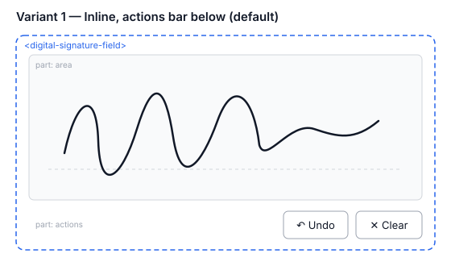

# Variant 1 — Inline, actions bar below (default)



The drawing area fills the field. Undo and Clear sit in the actions bar underneath, aligned to the end. This is what you get with **no configuration**.

**Use when:** the signature is a normal field in a form.

## Usage

**Vanilla JS**

```html
<form id="consent">
  <digital-signature-field name="signature" required></digital-signature-field>
  <button>Submit</button>
</form>
<script type="module">
  import '@digital-signature-field/element';
  document.querySelector('#consent').addEventListener('submit', (e) => {
    e.preventDefault();
    console.log(new FormData(e.target).get('signature')); // "data:image/svg+xml;base64,…"
  });
</script>
```

**Angular** (signal forms)

```ts
@Component({
  imports: [DsfSignature, FormField],
  template: `<dsf-signature [formField]="consent.signature" />`,
})
export class ConsentComponent {
  model = signal({ signature: null as string | null });
  consent = form(this.model, (p) => required(p.signature));
}
```

**React 19**

```tsx
<digital-signature-field ref={ref} name="signature" required />
// value: listen to `change` through the ref (see README → React)
```

**Vue 3**

```vue
<digital-signature-field :value="signature" @change="signature = $event.detail.value" required />
```

## Pros / cons

- ✅ No configuration needed, and it reads naturally: draw, then fix.
- ✅ The full width goes to drawing.
- ➖ Adds about 44px of height below the drawing area.
