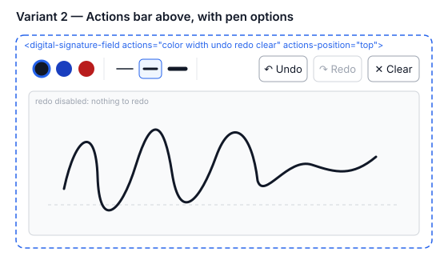

# Variant 2 — Actions bar above, with pen options



A top bar with ink colour swatches (`penColors`), three pen widths, and Undo / Redo / Clear. Unavailable actions (here Redo) render disabled. A new colour or width applies to the **next** stroke only; existing strokes keep theirs.

**Use when:** users sign documents and choose an ink colour, e.g. blue for "wet-ink" look.

## Usage

**Vanilla JS**

```html
<digital-signature-field
  actions="color width undo redo clear"
  actions-position="top"
  pressure></digital-signature-field>
<script type="module">
  import '@digital-signature-field/element';
  document.querySelector('digital-signature-field').penColors = ['#000', '#1a3fbf', '#b91c1c'];
</script>
```

**Angular**

```html
<dsf-signature
  [formField]="doc.signature"
  actions="color width undo redo clear"
  actionsPosition="top"
  [penColors]="['#000', '#1a3fbf', '#b91c1c']"
  [pressure]="true" />
```

**React 19** — React 19 sets unknown props on custom elements as properties, so arrays pass straight through:

```tsx
<digital-signature-field
  ref={ref}
  actions="color width undo redo clear"
  actions-position="top"
  penColors={['#000', '#1a3fbf', '#b91c1c']}
  pressure />
```

**Vue 3** — `.prop` forces a property binding:

```vue
<digital-signature-field
  actions="color width undo redo clear"
  actions-position="top"
  :penColors.prop="['#000', '#1a3fbf', '#b91c1c']"
  pressure />
```

## Pros / cons

- ✅ Everything a "real" signing pad has, still one tag.
- ✅ Redo is visible, which helps users who undo by mistake.
- ➖ Busier; on narrow phones the bar wraps to two rows.
- ➖ Colour choice is a product decision; most forms should not offer it.
