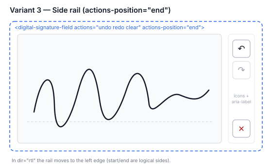

# Variant 3 — Side rail



Icon-only buttons stacked in a rail on the inline-end side. Positions are **logical**: `end` is on the right in LTR and on the left in `dir="rtl"`, so the legacy Hebrew layout works without extra CSS. Destructive Clear is separated from Undo/Redo at the bottom of the rail.

**Use when:** vertical space is scarce (landscape tablets, kiosk screens), or the signature box is wide and short.

## Usage

**Vanilla JS**

```html
<digital-signature-field dir="rtl" actions="undo redo clear" actions-position="end"></digital-signature-field>
<script type="module">
  import '@digital-signature-field/element';
  document.querySelector('digital-signature-field').labels = {
    undo: 'בטל', redo: 'בצע שוב', clear: 'נקה',
  };
</script>
```

**Angular**

```html
<dsf-signature
  [formField]="form.signature"
  dir="rtl"
  actions="undo redo clear"
  actionsPosition="end"
  [labels]="{ undo: 'בטל', redo: 'בצע שוב', clear: 'נקה' }" />
```

**React 19**

```tsx
<digital-signature-field dir="rtl" actions="undo redo clear" actions-position="end"
  labels={{ undo: 'בטל', redo: 'בצע שוב', clear: 'נקה' }} ref={ref} />
```

**Vue 3**

```vue
<digital-signature-field dir="rtl" actions="undo redo clear" actions-position="end"
  :labels.prop="{ undo: 'בטל', redo: 'בצע שוב', clear: 'נקה' }" />
```

## Pros / cons

- ✅ Keeps full drawing height; good for short boxes.
- ✅ Natural RTL behaviour through logical positions.
- ➖ Icons only: labels live in `aria-label` and a tooltip, which is less discoverable than text buttons.
- ➖ Takes ~56px of width; not ideal on narrow portrait phones (switch to `bottom` with a media query in the app).
