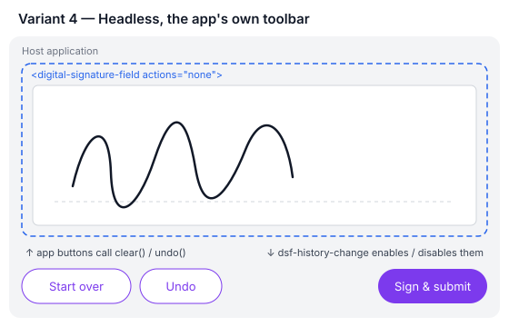

# Variant 4 — Headless, the app's own toolbar



`actions="none"` hides the actions bar. The app renders its own buttons in its own design system and drives the field through `undo()`, `redo()`, `clear()`. It listens to `dsf-history-change` to enable or disable them.

**Use when:** the app has a design system, or the actions belong to a wizard footer ("Start over", "Sign & submit").

## Usage

**Vanilla JS**

```html
<digital-signature-field id="sig" actions="none" name="signature" required></digital-signature-field>
<button id="undo" disabled>Undo</button>
<button id="clear" disabled>Start over</button>
<script type="module">
  import '@digital-signature-field/element';
  const sig = document.querySelector('#sig');
  undo.onclick = () => sig.undo();
  clear.onclick = () => sig.clear();
  sig.addEventListener('dsf-history-change', (e) => {
    undo.disabled = !e.detail.canUndo;
    clear.disabled = e.detail.empty;
  });
</script>
```

**Angular**

```ts
@Component({
  imports: [DsfSignature, FormField, MatButton],
  template: `
    <dsf-signature #sig [formField]="consent.signature" actions="none"
                   (historyChange)="history.set($event)" />
    <button mat-button (click)="sig.undo()" [disabled]="!history().canUndo">Undo</button>
    <button mat-button (click)="sig.clear()" [disabled]="history().empty">Start over</button>
  `,
})
export class ConsentComponent {
  history = signal({ canUndo: false, canRedo: false, empty: true });
  // …form as in variant 1
}
```

**React 19**

```tsx
const ref = useRef<DigitalSignatureFieldElement>(null);
const [h, setH] = useState({ canUndo: false, empty: true });
useEffect(() => {
  const el = ref.current!;
  const on = (e: Event) => setH((e as CustomEvent).detail);
  el.addEventListener('dsf-history-change', on);
  return () => el.removeEventListener('dsf-history-change', on);
}, []);

return (<>
  <digital-signature-field ref={ref} actions="none" />
  <Button onClick={() => ref.current?.undo()} disabled={!h.canUndo}>Undo</Button>
  <Button onClick={() => ref.current?.clear()} disabled={h.empty}>Start over</Button>
</>);
```

**Vue 3**

```vue
<script setup lang="ts">
const sig = ref<DigitalSignatureFieldElement>();
const h = ref({ canUndo: false, empty: true });
</script>
<template>
  <digital-signature-field ref="sig" actions="none" @dsf-history-change="h = $event.detail" />
  <button @click="sig?.undo()" :disabled="!h.canUndo">Undo</button>
  <button @click="sig?.clear()" :disabled="h.empty">Start over</button>
</template>
```

## Pros / cons

- ✅ Full control over look and placement; nothing to restyle.
- ✅ Same history and value logic as the built-in bar — the app only renders buttons.
- ➖ Keyboard shortcuts still work, but the app owns the button accessibility (labels, focus order).
- ➖ More code in every app.
