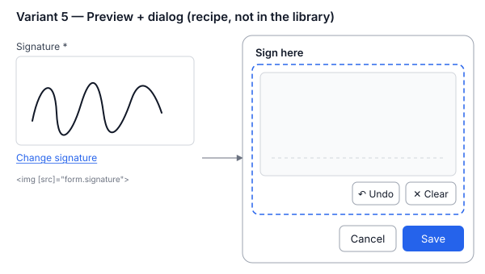

# Variant 5 — Preview + dialog (recipe)



How the legacy app worked. The form shows a small preview: the value rendered as an ``, which works because `svg` and `png` values are data URLs. A "Change signature" link opens a dialog holding a signature field. **Save** copies the dialog's value into the form; **Cancel** discards it.

The library does **not** ship this as a component (ADR-0011), because every app already has its own dialog. It is a recipe in the demo apps.

**Use when:** the form is long and the signature is a small part of it, or on phones, where a full-screen dialog gives room to sign.

## Usage

**Vanilla JS** — native `<dialog>`:

```html

<button type="button" id="open">Add signature</button>
<input type="hidden" name="signature" id="hidden">

<dialog id="dlg">
  <digital-signature-field id="sig"></digital-signature-field>
  <button id="cancel">Cancel</button> <button id="save">Save</button>
</dialog>

<script type="module">
  import '@digital-signature-field/element';
  open.onclick = () => { sig.value = hidden.value || null; dlg.showModal(); };
  cancel.onclick = () => dlg.close();
  save.onclick = () => {
    hidden.value = sig.value ?? '';
    preview.src = sig.value ?? ''; preview.hidden = !sig.value;
    dlg.close();
  };
</script>
```

**Angular** — `MatDialog`; the dialog edits a copy:

```ts
openSignature() {
  this.dialog.open(SignatureDialog, { data: this.model().signature })
    .afterClosed()
    .subscribe((v) => v !== undefined && this.model.update((m) => ({ ...m, signature: v })));
}
// SignatureDialog template:
// <dsf-signature [(value)]="draft" />  <button (click)="ref.close(draft())">Save</button>
```

**React 19 / Vue 3** — same pattern with the app's own modal. Keep a `draft` state inside the modal and copy it to the form state on Save.

## Pros / cons

- ✅ Compact in the form; generous room to sign in the dialog.
- ✅ Cancel is free: the form value only changes on Save.
- ➖ An extra click; the signature can't be fixed in place.
- ➖ Dialog accessibility and sizing are the app's job.
- ➖ Not reusable as one tag — by design.
