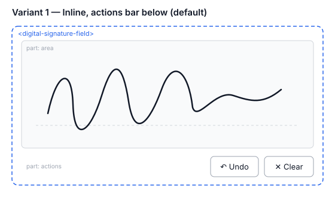
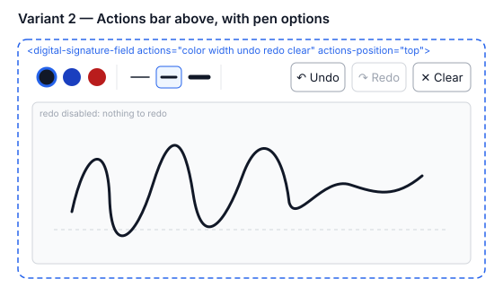
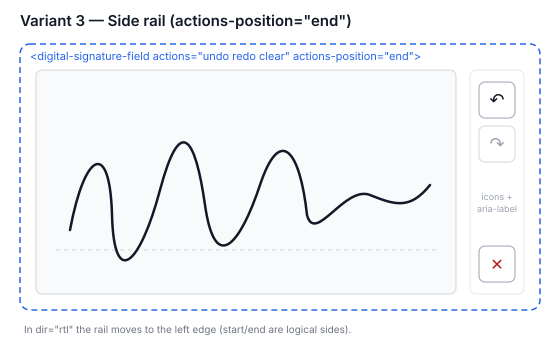
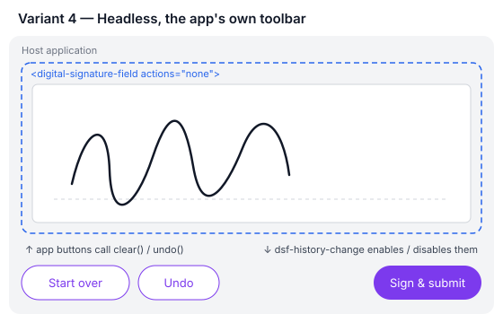
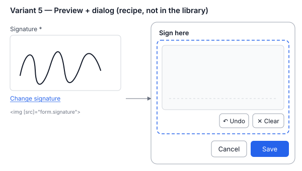

# Layout & integration variants

Five ways to present and drive the signature field. Variants 1–4 are **one element with different settings**. Variant 5 is a **recipe** that composes the element with the app's own dialog (ADR-0011).

| # | Variant | Setting | Best for |
| --- | --- | --- | --- |
| 1 | [Inline, actions bar below](./01-inline-bottom-bar.md) | defaults | Most forms. **The default.** |
| 2 | [Actions bar above, with pen options](./02-top-bar-pen-options.md) | `actions="color width undo redo clear" actions-position="top"` | Document-signing UIs where users pick an ink colour |
| 3 | [Side rail](./03-side-rail.md) | `actions-position="end"` | Wide or short layouts, tablets in landscape, RTL |
| 4 | [Headless, the app's own toolbar](./04-headless-external-toolbar.md) | `actions="none"` + methods/events | Apps with a design system or a wizard footer |
| 5 | [Preview + dialog](./05-preview-and-dialog.md) | recipe in the demo apps | Long forms where the signature is one small field |

  
  
  
  
  

## Recommendation

Ship **variant 1 as the default**, and make 2, 3 and 4 reachable purely through the `actions` / `actions-position` settings, so they cost no extra components. Document variant 5 as a recipe in `demo-angular`, `demo-react` and `demo-vue`.

Every variant page assumes the package is installed and registered as shown in the [README](../../README.md#install).
